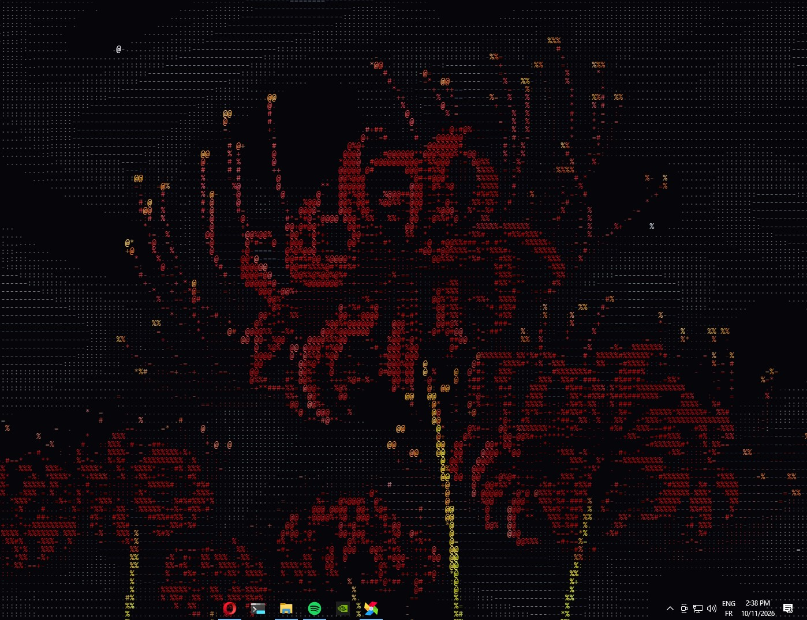
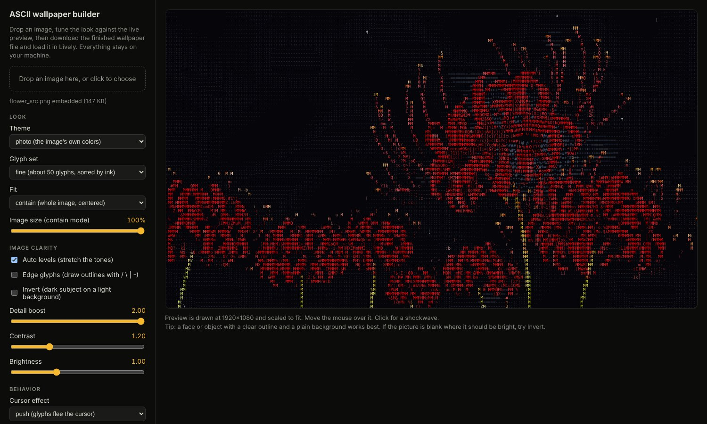
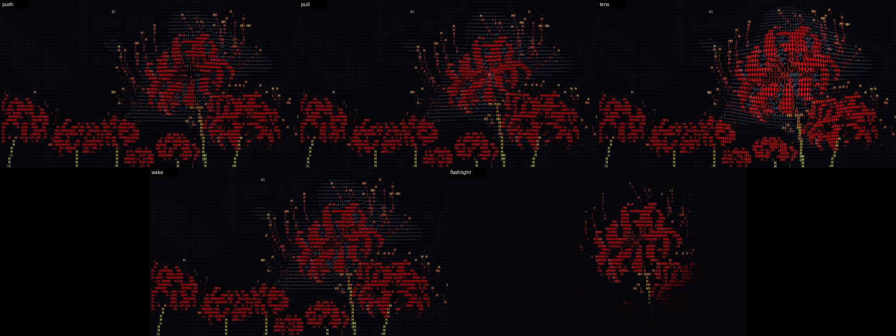
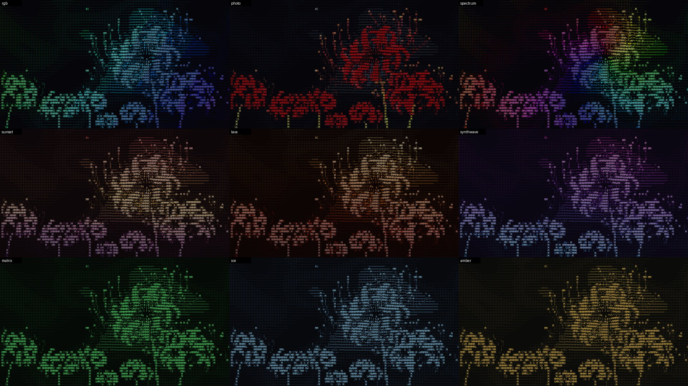

# ASCII Cursor Wallpaper

Turn any picture into an **interactive ASCII-art desktop wallpaper** that reacts to your cursor, and tune it live in your browser before you use it.

It is one self-contained HTML file: no install, no server, no dependencies, and **no network access**.



<sub>Running as a live wallpaper on a Windows desktop (via Lively). Artwork credit below.</sub>



## What it does

- **Image to ASCII** with a glyph set sorted by how much ink each character really has, auto levels, detail boost, and optional outline glyphs (`/ \ | -`).
- **Cursor effects:** push, pull, lens, wake (glyphs get dragged along your motion), flashlight.
- **Click effects:** soft ripple or hard burst.
- **Photo reveal:** the original photo shows through, in a soft wobbling blob, wherever the cursor has been.
- **Themes:** rgb rainbow, photo colors, spectrum (hue follows the cursor), sunset, lava, synthwave, matrix, ice, amber, magenta, mono.
- **Idle mode:** a ghost cursor wanders so the wallpaper never looks frozen.
- **Settings:** save and load your look as a small JSON file (your last settings are also remembered in the browser).
- **Light on the CPU:** frame cap plus an adaptive throttle that slows down when your machine struggles.

**Cursor effects** (push, pull, lens, wake, flashlight):



**Photo reveal** (the original picture shows through around the cursor):




## Quick start

1. Open `ascii-wallpaper-builder.html` in a browser (double-click it).
2. Drop an image on the page. A clear subject on a plain background works best.
3. Tune the look against the live preview. Pick the preview size that matches your monitor under *Performance & screen* if you want the framing to match.
4. Click **Download wallpaper** to get a single `.html` file.

### Use it as your desktop wallpaper (Windows)

This was built for [Lively Wallpaper](https://github.com/rocksdanister/lively) (free, open source):

1. In Lively, click **+** then **Browse** and choose the downloaded `.html` file (or drag the file itself into the Lively window).

### Change settings from inside Lively

Click **Download for Lively with settings (.zip)** instead:

1. Extract the zip into a folder you will keep (it contains `index.html` and `LivelyProperties.json`).
2. In Lively, add `index.html` as above. Do not drag the folder, and keep both files next to each other.
3. On the wallpaper's tile, open the **...** menu and choose **Customise** to change colors, effects, sizes and more live.

Lively reads `LivelyProperties.json` from the folder of a directly added html file, which is how the settings panel appears. Your image and starting values are baked into `index.html`.

## Privacy

Everything happens locally. The builder page ships with a strict Content-Security-Policy (`default-src 'none'`, `connect-src 'none'`), your image is embedded in the output file as a data URI, and the automated tests assert that neither the builder, the preview nor any generated wallpaper makes a single network request.

## Tests

```bash
pip install -r tests/requirements.txt pillow
playwright install chromium
python tests/smoke_test.py
```

The suite drives a real headless Chromium: it renders every cursor effect and theme, a downloaded wallpaper, photo reveal, and the Lively export (valid zip, well-formed settings file, clean restarts when settings change), round-trips the settings file, feeds it hostile values, and checks there are zero network requests and zero console errors.

## Honest notes

- Developed and used on Windows with Lively. The automated tests run headless, so real frame rates on your hardware may differ: enable *Show FPS in the wallpaper* under *Performance & screen* to check. If it is heavy, raise the character size or lower the frame cap.
- The wallpaper reacts to the mouse only while it is visible, meaning over the bare desktop and not over open windows. Mouse input is on by default in Lively; if the wallpaper does not react, check Lively's wallpaper input settings.
- The embedded image is downscaled to 960 px on its longest side to keep the output file small, so photo reveal is slightly softer than the original on very large screens.
- Other wallpaper hosts that load a local HTML file (for example Wallpaper Engine's web type) should work for the plain `.html` output but are untested.

## Credits

- Demo wallpaper: red spider lily artwork from [Wallhaven](https://wallhaven.cc/), uploaded by [leoscau](https://wallhaven.cc/user/leoscau). The original artist is not known to the author, and the artwork itself is not included in this repository, only ASCII renderings of it. If you are the artist and want it credited differently or removed, please open an issue.
- Test and photo-reveal image: astronaut portrait of Eileen Collins, NASA, public domain (as distributed with [scikit-image](https://scikit-image.org/)).

Made by Yasser Chettour.

## License

[MIT](LICENSE)
